<picture>
  <source media="(prefers-color-scheme: dark)" srcset="assets/header-dark.svg">
  <source media="(prefers-color-scheme: light)" srcset="assets/header-light.svg">
  
</picture>

 

I build **agentic AI systems**: multi-agent orchestration, tool-using agents, and pipelines that run in production. I also fine-tune the language models behind them, with RL among the methods I use.

 

### Selected work

| Project | What it does | Built with |
|:--|:--|:--|
| [**AutoOps AI**](https://github.com/anandn1/agentic-devops-sandbox) | Five-node agentic DevOps network with sandboxed execution and RAG-based fault resolution | `AutoGen` `Docker` `ChromaDB` |
| [**Pathfinder AI**](https://github.com/anandn1/Pathfinder-AI-Pro) | Supervisor–worker career advisor with human-in-the-loop interrupt nodes and persistent state | `LangGraph` `PostgreSQL` |
| [**ContentModEnv**](https://github.com/anandn1/ContentModEnv) | RL environment for training content-moderation policies 🏆 Finalist, Meta PyTorch OpenEnv Hackathon | `PyTorch` `Gymnasium` |

 

### Stack

| | |
|:--|:--|
| **Agentic** | `LangGraph` `LangChain` `AutoGen` `LangSmith` |
| **ML / RL** | `PyTorch` `TRL` `Unsloth` `TensorFlow` `NumPy` `Pandas` |
| **Languages** | `Python` `C++` `Java` |
| **Serving & data** | `FastAPI` `Flask` `PostgreSQL` `ChromaDB` `Pinecone` |
| **Infra** | `Docker` `AWS` `Linux` |

 

### Elsewhere

